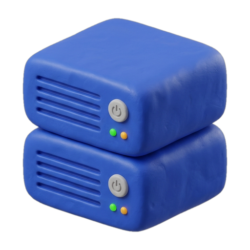

<p align="center">
  
</p>

<h1 align="center">Unitray</h1>

<p align="center">
  <strong>Lightweight, zero-bloat system service manager right inside your Linux system tray.</strong>
</p>

<p align="center">
  <a href="https://opensource.org/licenses/MIT"></a>
  <a href="https://www.rust-lang.org/"></a>
  <a href="https://www.qt.io/"></a>
  <a href="https://www.freedesktop.org/"></a>
  <a href="#-technical-specifications"></a>
  <a href="#-desktop-compatibility-matrix"></a>
</p>

---

## 📑 Table of Contents

- [Overview](#-overview)
- [Why Unitray?](#-why-unitray)
- [ASCII Menu Preview](#-ascii-menu-preview)
- [Quick Start & Usage](#-quick-start--usage)
- [Feature Highlights](#-feature-highlights)
- [Technical Specifications](#-technical-specifications)
- [Supported Init Systems](#-supported-init-systems)
- [Desktop Compatibility Matrix](#-desktop-compatibility-matrix)
- [Installation Guide](#-installation-guide)
  - [Prerequisites](#prerequisites)
  - [Option A: Build from Source (Cargo)](#option-a-build-from-source-cargo)
  - [Option B: Fedora / RHEL RPM](#option-b-fedora--rhel-rpm)
  - [Option C: Arch Linux / AUR](#option-c-arch-linux--aur)
- [Security & Passwordless Polkit Setup](#-security--passwordless-polkit-setup)
- [Autostart Setup](#-autostart-setup)
  - [Method 1: systemd User Service (Recommended)](#method-1-systemd-user-service-recommended)
  - [Method 2: XDG Desktop Autostart](#method-2-xdg-desktop-autostart)
- [Configuration Guide](#-configuration-guide)
  - [File Resolution](#file-resolution)
  - [Configuration Syntax](#configuration-syntax)
  - [Developer Stack Presets](#developer-stack-presets)
    - [1. Database Stack](#1-database-stack-mariadb-postgresql-redis-mongodb)
    - [2. Web & Container Stack](#2-web--container-stack-docker-podman-nginx-caddy)
    - [3. Dev Tunnels & Local AI Stack](#3-dev-tunnels--local-ai-stack-cloudflare-tunnel-ollama)
    - [4. The Kitchen Sink (Full-Stack Dev)](#4-the-kitchen-sink-full-stack-dev)
- [Troubleshooting & FAQ](#-troubleshooting--faq)
- [Roadmap](#-roadmap)
- [License](#-license)

---

## 🔍 Overview

**Unitray** is a modern, ultra-lightweight system tray controller engineered specifically for developers, sysadmins, and Linux power users who want rapid, one-click access to local services—such as MariaDB, PostgreSQL, Docker, Podman, Redis, Nginx, Ollama, or Cloudflare Tunnels—without having to open a terminal or launch bloated GUI service managers.

Unitray employs a clean, high-performance hybrid architecture:
1. **Tray Daemon (`unitray`)**: Built with pure **Rust** and communicating directly via the native FreeDesktop **StatusNotifierItem (SNI)** D-Bus protocol (`ksni`/`zbus`). The resident background daemon requires **zero GUI libraries**, sitting silently in your status bar while sipping a microscopic **~3.5 MB of RAM**.
2. **Settings GUI (`unitray-settings`)**: Built with native **C++20 & Qt 6 Widgets**. Unlike non-native or flat-rendered GUIs, the settings window natively adopts your desktop environment’s look, feel, widgets, and themes (such as **KDE Plasma Breeze** or **GNOME Adwaita**), launching in milliseconds with an ultra-compact ~186 KB footprint.

---

## 💡 Why Unitray?

| Concern | Heavy GUI Managers (system-config-services, Electron GUIs) | CLI Only (`systemctl`) | **Unitray** |
| :--- | :--- | :--- | :--- |
| **Daemon Memory** | 80 MB – 350+ MB RAM | 0 MB (Not resident) | **~3.5 MB RAM** (Pure Rust daemon) |
| **Startup Time** | Slow (2–5 seconds) | Instantaneous | **Instantaneous (< 20ms)** |
| **Settings UI** | Heavy Electron / Webview | None | **Native C++ Qt 6** (~186 KB, native OS theme) |
| **Visual Glanceability** | Must launch window | None (must type `systemctl status`) | **Permanent, live status in panel** |
| **Convenience** | Multi-window navigation | Manual typing & sudo passwords | **Single-click toggle & batch actions** |
| **Root Prompts** | Repetitive password dialogs | Prompts for `sudo` | **Granular, secure Polkit rules** |

- **Zero Resident GUI Bloat**: The background daemon has zero GUI toolkit overhead. It emits standard D-Bus StatusNotifierItem signals rendered directly by your system panel.
- **Native OS Style Adaptation**: The C++ Qt 6 configuration tool matches your host desktop environment seamlessly—supporting KDE Breeze, dark/light color schemes, native fonts, and system icon themes.
- **Microscopic Resource Footprint**: The Rust daemon compiles to **~1.9 MB** and uses **~3.5 MB RAM**; the C++ settings utility compiles to **~186 KB**.
- **Instant State Feedback**: Polling keeps status in sync, and opening the menu triggers an immediate synchronous check so your view is never stale.
- **Batch Productivity Controls**: Toggle individual services or stop/restart all monitored services simultaneously during project context switches.
- **Frictionless Security**: Ships with Polkit rules granting your user passwordless privileges exclusively for designated developer services, leaving full root security intact.

---

## 🖥️ ASCII Menu Preview

Unitray docks cleanly into any modern Linux panel (Waybar, KDE Plasma System Tray, GNOME Top Bar, etc.):

```text
┌────────────────────────────────────────────────────────────────────────┐
│  [ Panel / Waybar / Top Bar ]                 [ ⚙ Unitray (2 active) ] │
└─────────────────────────────────────────────────────────┬──────────────┘
                                                          │ (Click)
                                                          ▼
               ┌─────────────────────────────────────────────────────────┐
               │    MariaDB                      [🟢 Running]            │
               │    Docker                       [🟢 Running]            │
               │    PostgreSQL                   [🔴 Stopped]            │
               │    Cloudflare Tunnel            [🔴 Stopped]            │
               │  ─────────────────────────────────────────────────────  │
               │  ↻  Restart All Services                                │
               │  ⏹  Stop All Services                                   │
               │  ─────────────────────────────────────────────────────  │
               │  ⚙  Settings...                                         │
               │  ℹ  About Unitray...                                    │
               │  ⏻  Quit Unitray                                        │
               └─────────────────────────────────────────────────────────┘
```

- **Clean Dropdown**: No checkmark clutter. Click any service item to instantly toggle between start and stop.
- **Vibrant Status Badges**: High-visibility status indicators (`[🟢 Running]` vs `[🔴 Stopped]`) give at-a-glance confirmation.
- **Batch Controls**: `Restart All Services` and `Stop All Services` let you spin down your entire development stack when packing up your laptop.
- **Graphical Settings UI**: `Settings...` launches the built-in GUI configuration tool (`unitray-settings`) to visually manage services, polling intervals, and icons.
- **Integrated Dialog**: `About Unitray...` displays author and version details using native desktop dialogs (`kdialog` -> `zenity` -> `notify-send`).

---

## 🎮 Quick Start & Usage

Using Unitray is completely intuitive:

1. **Start the tray application:**
   ```bash
   unitray
   ```
   A system service icon (`preferences-system-services`) immediately appears in your panel's system tray.

2. **Left-Click to View & Toggle Services:**
   - Click the tray icon to see real-time statuses:
     - `[🟢 Running]` for active services.
     - `[🔴 Stopped]` for inactive services.
   - Click any service to start or stop it instantly without password prompts.

3. **Manage via Graphical Settings:**
   - Click **`Settings...`** in the tray menu or run `unitray-settings` in your terminal to graphically add, remove, and reorder monitored services.
   - Any changes are saved to `~/.config/unitray/config.toml` and automatically hot-reloaded!

4. **Batch Control Actions:**
   - **`Restart All Services`**: Reloads all configured services in one click (useful when switching git branches or modifying configs).
   - **`Stop All Services`**: Safely shuts down your entire local development stack when leaving your workstation or conserving battery.

---

## ⚡ Feature Highlights

- **Pure Rust StatusNotifierItem (SNI)**: Utilizes `ksni` with D-Bus backing. Works natively on both Wayland compositors and X11 display servers.
- **Dynamic State Refresh**:
  - Automatically queries service states on a configurable interval (default: 3 seconds).
  - Triggers an instant state verification immediately before the tray menu opens (`menu_about_to_show`), guaranteeing zero stale indicators.
  - Automatically reflects changes made externally via CLI `systemctl`.
- **Configurable TOML Architecture**:
  - Custom list of systemd service units.
  - Custom display names and icons.
  - Configurable polling intervals.
- **Passwordless Polkit Integration**:
  - Bundled Polkit rule authorizes `wheel` (or `sudo`) group users to start, stop, and restart whitelisted development units without password prompts.
- **Zero-Crash Resilience**:
  - Gracefully falls back to sensible defaults if configuration files are missing or contain parse errors.
  - Handles missing service units without panics.

---

## 📊 Technical Specifications

| Component | Implementation | Technology | Footprint |
| :--- | :--- | :--- | :--- |
| **Tray Daemon (`unitray`)** | Resident background daemon | Pure Rust 2024 (`ksni`, `zbus`) | **~1.9 MB** binary, **~3.5 MB RAM** |
| **Settings GUI (`unitray-settings`)** | Native desktop configuration UI | Native C++20 & Qt 6 Widgets | **~186 KB** binary, native OS styling |
| **D-Bus Protocol** | FreeDesktop `org.kde.StatusNotifierItem` | Native SNI signals | Zero daemon toolkit dependencies |
| **Display Protocol** | Wayland & X11 compatible | Freedesktop compliance | Instant render via panel tray |
| **IPC Mechanism** | Systemd manager (`org.freedesktop.systemd1`) | D-Bus / `systemctl` | Zero daemon overhead |

---

## 🚦 Supported Init Systems

Unitray is architected with modular service backends:

| Init System | Status | Mechanism | Capabilities |
| :--- | :--- | :--- | :--- |
| **systemd** | **Fully Supported** | `systemctl is-active`, `start`, `stop`, `restart` / D-Bus | Real-time status query, single toggle, batch restart/stop, Polkit passwordless execution |
| **OpenRC** | **Roadmap** | `rc-service <name> status/start/stop` | Targeted for Alpine Linux & Gentoo developers |
| **runit** | **Roadmap** | `sv status/up/down <service>` | Targeted for Void Linux developers |

---

## 🖥️ Desktop Compatibility Matrix

Because Unitray implements the standard FreeDesktop StatusNotifierItem (SNI) specification, it integrates with almost every desktop environment and Wayland status bar:

| Desktop / Panel | Display Server | Support Level | Requirements / Notes |
| :--- | :--- | :---: | :--- |
| **KDE Plasma 6 & 5** | Wayland / X11 | **Native** | Works out of the box in the default System Tray widget. Settings UI renders in native KDE Breeze style! |
| **GNOME Shell (40–47+)** | Wayland / X11 | **Supported** | Requires the popular [AppIndicator and KStatusNotifierItem Support](https://extensions.gnome.org/extension/615/appindicator-support/) GNOME extension. |
| **Waybar** (Sway / Hyprland) | Wayland | **Native** | Enable the built-in `"tray"` module in your `~/.config/waybar/config`. |
| **Hyprland** (Hyprpanel / ags) | Wayland | **Native** | Works with any SNI-compliant bar widget. |
| **XFCE Panel** | X11 | **Native** | Ensure the **Status Notifier Plugin** item is added to your XFCE panel. |
| **Polybar** | X11 | **Supported** | Supported via Polybar's native `tray-position = right` directive. |
| **i3 / bspwm / AwesomeWM** | X11 | **Supported** | Works with standalone trays like `trayer`, `stalonetray`, or `tint2`. |

---

## 📦 Installation Guide

### Prerequisites

Ensure you have a working Rust toolchain, C++ compiler, CMake, and Qt 6 development libraries:

```bash
# Check Rust version (MSRV 1.85+)
rustc --version
cargo --version

# On Fedora / RHEL
sudo dnf install -y git gcc gcc-c++ cmake qt6-qtbase-devel

# On Arch Linux / Manjaro
sudo pacman -S --needed git base-devel cmake qt6-base

# On Ubuntu / Debian
sudo apt update && sudo apt install -y git build-essential cmake qt6-base-dev
```

---

### Option A: Build from Source

1. **Clone the repository:**

   ```bash
   git clone https://github.com/Khuirul-Huda/unitray.git
   cd unitray
   ```

2. **Compile the Rust Tray Daemon and Native C++ Qt 6 Settings GUI:**

   ```bash
   # Build tray daemon (Rust)
   cargo build --release

   # Build settings UI (C++ Qt 6)
   cmake -B build -DCMAKE_BUILD_TYPE=Release
   cmake --build build -j$(nproc)
   ```

3. **Install the binaries to `/usr/local/bin`:**

   ```bash
   sudo install -m 0755 target/release/unitray /usr/local/bin/unitray
   sudo install -m 0755 build/unitray-settings /usr/local/bin/unitray-settings
   ```

4. **Install default configuration, desktop entries, and Polkit rules:**

   ```bash
   # Copy default configuration to your user directory
   mkdir -p ~/.config/unitray
   cp config/unitray.toml ~/.config/unitray/config.toml

   # Install desktop launchers & icons
   mkdir -p ~/.local/share/applications ~/.local/share/pixmaps
   cp data/unitray.desktop ~/.local/share/applications/
   cp data/unitray-settings.desktop ~/.local/share/applications/
   cp data/unitray.png ~/.local/share/pixmaps/

   # Install Polkit rule for passwordless service control (requires sudo)
   sudo cp data/49-unitray.rules /etc/polkit-1/rules.d/
   ```

---

### Option B: Fedora / RHEL RPM

A complete RPM spec file is included in [`packaging/unitray.spec`](packaging/unitray.spec).

```bash
# Install RPM build dependencies
sudo dnf install -y rpm-build rust cargo

# Setup RPM tree
mkdir -p ~/rpmbuild/{BUILD,RPMS,SOURCES,SPECS,SRPMS}

# Create source archive
tar --transform 's,^,unitray-0.1.0/,' -czvf ~/rpmbuild/SOURCES/unitray-0.1.0.tar.gz \
    --exclude='.git' --exclude='target' .

# Copy spec file and build
cp packaging/unitray.spec ~/rpmbuild/SPECS/
rpmbuild -ba ~/rpmbuild/SPECS/unitray.spec

# Install the built RPM package
sudo dnf install ~/rpmbuild/RPMS/x86_64/unitray-0.1.0-1*.rpm
```

---

### Option C: Arch Linux / AUR

A standard [`packaging/PKGBUILD`](packaging/PKGBUILD) is provided for Arch Linux users:

```bash
cd packaging
makepkg -si
```

This compiles the Rust tray daemon and C++ Qt 6 settings GUI, installs `unitray` and `unitray-settings` to `/usr/bin/`, places the systemd user service in `/usr/lib/systemd/user/unitray.service`, installs the desktop entries and icons, and registers the Polkit rules in `/usr/share/polkit-1/rules.d/49-unitray.rules`.

---

## 🔐 Security & Passwordless Polkit Setup

Controlling system-level services (`mariadb.service`, `docker.service`, etc.) normally triggers Polkit authentication prompts or requires `sudo`. Unitray solves this cleanly using PolicyKit rules without compromising your system security.

The bundled file `data/49-unitray.rules` allows members of the administrative group (`wheel` on Fedora/Arch, or `sudo` on Debian/Ubuntu) to run `start`, `stop`, and `restart` on specified development units:

```javascript
/* /etc/polkit-1/rules.d/49-unitray.rules */
polkit.addRule(function(action, subject) {
    if (action.id == "org.freedesktop.systemd1.manage-units" && 
        (subject.isInGroup("wheel") || subject.isInGroup("sudo"))) {
        
        var verb = action.lookup("verb");
        var unit = action.lookup("unit");
        var allowedVerbs = ["start", "stop", "restart"];
        var devUnits = [
            "mariadb.service",
            "postgresql.service",
            "docker.service",
            "cloudflared.service",
            "redis.service",
            "nginx.service",
            "httpd.service",
            "mongodb.service",
            "ollama.service",
            "podman.service",
            "caddy.service"
        ];
        
        if (allowedVerbs.indexOf(verb) !== -1 && devUnits.indexOf(unit) !== -1) {
            return polkit.Result.YES;
        }
    }
});
```

### Installing the Polkit Rule

```bash
sudo cp data/49-unitray.rules /etc/polkit-1/rules.d/
sudo chmod 644 /etc/polkit-1/rules.d/49-unitray.rules
```

> [!NOTE]
> If your distribution uses the `sudo` group instead of `wheel` (e.g. Debian/Ubuntu), ensure `subject.isInGroup("sudo")` is present in your rule.

Test that passwordless control works via the terminal:

```bash
systemctl stop mariadb.service
systemctl start mariadb.service
# Should succeed immediately without asking for a password!
```

---

## 🚀 Autostart Setup

Choose either a systemd user service or standard XDG desktop autostart:

### Method 1: systemd User Service (Recommended)

Running Unitray under `systemd --user` ensures automatic restarts on failure and clean lifecycle binding with your graphical session.

```bash
# 1. Create the user service directory
mkdir -p ~/.config/systemd/user

# 2. Copy the unit file
cp data/unitray.service ~/.config/systemd/user/

# 3. Reload systemd user daemon and enable
systemctl --user daemon-reload
systemctl --user enable --now unitray.service
```

To inspect status or logs:

```bash
systemctl --user status unitray.service
journalctl --user -u unitray.service -f
```

---

### Method 2: XDG Desktop Autostart

For desktop environments that manage startup entries via XDG desktop files (KDE Plasma, GNOME, XFCE):

```bash
mkdir -p ~/.config/autostart
cp data/unitray.desktop ~/.config/autostart/
```

Unitray will start automatically on your next desktop login.

---

## ⚙️ Configuration Guide

### File Resolution

When Unitray launches, it searches for its configuration file in the following order:

1. **User configuration**: `~/.config/unitray/config.toml`
2. **System-wide configuration**: `/etc/unitray/config.toml`
3. **Internal defaults**: Fallback to MariaDB, PostgreSQL, Docker, and Cloudflare Tunnel if no config file is found.

---

### Configuration Syntax

```toml
# ==============================================================================
# Unitray Configuration File (~/.config/unitray/config.toml)
# ==============================================================================

# Polling interval in seconds to sync service states with systemd
refresh_interval_secs = 3

# Fallback tray icon name from your active FreeDesktop icon theme
# Examples: "preferences-system-services", "server-database", "network-server"
tray_icon = "preferences-system-services"

# List of services to monitor and manage
[[services]]
name = "MariaDB"            # Friendly display name shown in tray menu
unit = "mariadb.service"    # Exact systemd unit file name

[[services]]
name = "Docker Engine"
unit = "docker.service"
```

| Key | Type | Default | Description |
| :--- | :---: | :---: | :--- |
| `refresh_interval_secs` | `integer` | `3` | Background polling period (in seconds) to query `systemctl is-active`. |
| `tray_icon` | `string` | `"preferences-system-services"` | FreeDesktop icon name displayed in the system tray. |
| `services` | `array` | *(Default 4 services)* | Array of service tables containing `name` and `unit`. |
| `services.name` | `string` | *(Required)* | Human-readable label displayed in the dropdown menu. |
| `services.unit` | `string` | *(Required)* | Full systemd unit name (e.g. `postgresql.service`, `redis.service`). |

---

### Developer Stack Presets

Below are ready-to-copy configuration presets tailored for common developer stacks. Save any of these to `~/.config/unitray/config.toml`:

#### 1. Database Stack (MariaDB, PostgreSQL, Redis, MongoDB)

Perfect for backend developers managing local database instances:

```toml
refresh_interval_secs = 2
tray_icon = "server-database"

[[services]]
name = "MariaDB Server"
unit = "mariadb.service"

[[services]]
name = "PostgreSQL DB"
unit = "postgresql.service"

[[services]]
name = "Redis In-Memory Cache"
unit = "redis.service"

[[services]]
name = "MongoDB Server"
unit = "mongodb.service"
```

---

#### 2. Web & Container Stack (Docker, Podman, Nginx, Caddy)

Ideal for DevOps, frontend, and microservices developers:

```toml
refresh_interval_secs = 3
tray_icon = "network-server"

[[services]]
name = "Docker Daemon"
unit = "docker.service"

[[services]]
name = "Podman Service"
unit = "podman.service"

[[services]]
name = "Nginx Web Server"
unit = "nginx.service"

[[services]]
name = "Caddy Reverse Proxy"
unit = "caddy.service"
```

---

#### 3. Dev Tunnels & Local AI Stack (Cloudflare Tunnel, Ollama)

Tailored for AI engineers and developers exposing local web servers to the internet:

```toml
refresh_interval_secs = 3
tray_icon = "utilities-system-monitor"

[[services]]
name = "Cloudflare Tunnel"
unit = "cloudflared.service"

[[services]]
name = "Ollama Local LLM"
unit = "ollama.service"

[[services]]
name = "Docker Daemon"
unit = "docker.service"

[[services]]
name = "PostgreSQL (pgvector)"
unit = "postgresql.service"
```

---

#### 4. The Kitchen Sink (Full-Stack Dev)

Manage your databases, proxies, tunnels, and containers in one place:

```toml
refresh_interval_secs = 3
tray_icon = "preferences-system-services"

[[services]]
name = "PostgreSQL"
unit = "postgresql.service"

[[services]]
name = "MariaDB"
unit = "mariadb.service"

[[services]]
name = "Redis"
unit = "redis.service"

[[services]]
name = "Docker"
unit = "docker.service"

[[services]]
name = "Nginx"
unit = "nginx.service"

[[services]]
name = "Ollama AI"
unit = "ollama.service"

[[services]]
name = "Cloudflare Tunnel"
unit = "cloudflared.service"
```

> [!TIP]
> Whenever you add new service units to `config.toml`, make sure the unit names are also included in your Polkit rules (`/etc/polkit-1/rules.d/49-unitray.rules`) to allow passwordless toggling!

---

## 🔧 Troubleshooting & FAQ

### 1. The tray icon does not appear on GNOME Shell
GNOME Shell removed native system tray support in version 3.26. To restore StatusNotifierItem support, install the official [AppIndicator and KStatusNotifierItem Support extension](https://extensions.gnome.org/extension/615/appindicator-support/):

```bash
# On Fedora
sudo dnf install gnome-shell-extension-appindicator

# On Ubuntu
sudo apt install gnome-shell-extension-appindicator

# On Arch Linux
sudo pacman -S gnome-shell-extension-appindicator
```
Enable the extension via **GNOME Extensions** or `gnome-extensions enable appindicatorsupport@rgcjonas.gmail.com`.

---

### 2. Password prompt appears when clicking a service
If toggling a service prompts for authentication:
1. Verify that your user belongs to the `wheel` (or `sudo`) group:
   ```bash
   groups
   ```
2. Verify that `/etc/polkit-1/rules.d/49-unitray.rules` exists and contains the exact unit name (e.g. `redis.service`).
3. Ensure file permissions are set correctly:
   ```bash
   sudo chmod 644 /etc/polkit-1/rules.d/49-unitray.rules
   ```

---

### 3. Waybar does not display the Unitray tray item
Ensure your Waybar configuration file (`~/.config/waybar/config`) includes the `"tray"` module in `"modules-right"` or `"modules-left"`:

```json
"modules-right": [
    "tray",
    "clock"
],
"tray": {
    "icon-size": 18,
    "spacing": 8
}
```

---

### 4. Customizing the Tray Icon
You can specify any icon available in your system's icon theme (e.g., Papirus, Breeze, Adwaita) inside `config.toml`:

```toml
tray_icon = "server-database"
# or
tray_icon = "system-run"
# or
tray_icon = "network-server"
```

---

## 🗺️ Roadmap

- [x] FreeDesktop StatusNotifierItem (SNI) implementation with pure Rust
- [x] Systemd service lifecycle management (start, stop, restart, poll)
- [x] TOML configuration with automatic path resolution
- [x] Passwordless Polkit security rules
- [x] Packaging for Fedora RPM and Arch Linux PKGBUILD
- [ ] **OpenRC backend**: Support Alpine Linux, Gentoo, and Artix via `rc-service`
- [ ] **runit backend**: Support Void Linux via `sv`
- [ ] **Custom command hooks**: Trigger pre-start / post-stop scripts per service
- [ ] **User systemd services**: Toggle `systemctl --user` units directly from the same menu
- [ ] **Desktop notifications**: Optional toast notifications on service failure

---

## 📄 License

Distributed under the **MIT License**. See [LICENSE](LICENSE) for more information.
